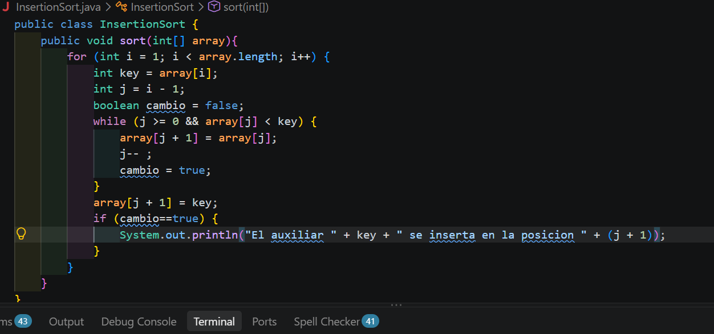
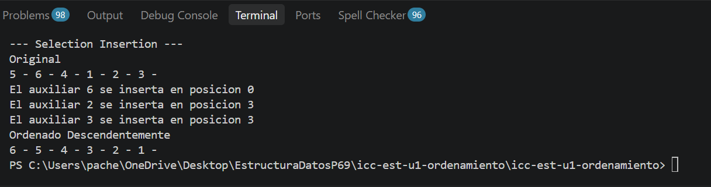

Metodo Insertion

##Se utilizo el metodo insertion para ordenar un arreglo de forma descendente. Se creo una variable key para guardar el valor mayor e insertarlo en la posicion i. Tambien se creo la variable booleana cambio para imprimir caundo habia cambios  

Resultado
