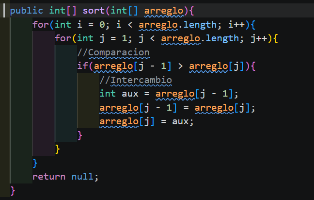
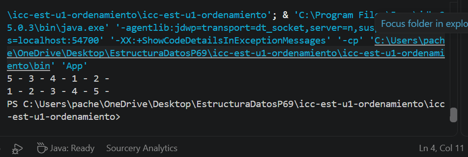
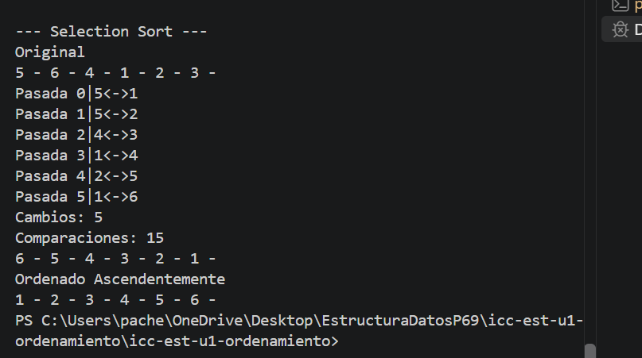
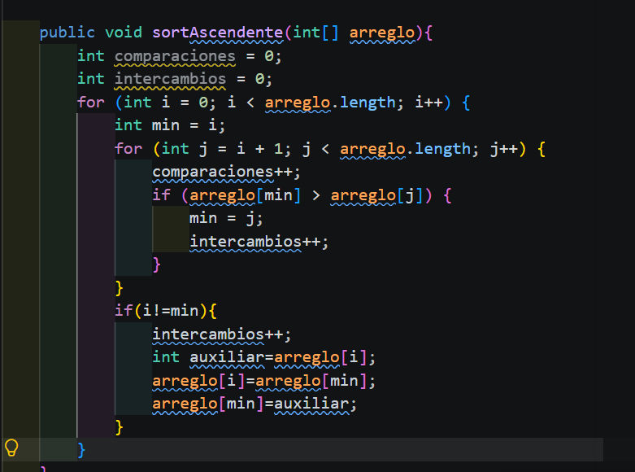

Metodo Burbuja

Resultado

Metodo Selection

##Se utilizo el metodo seleccion para ordenar un arreglo. A diferencia de bubble, se creo una variable min para guardar el valor menor. La variable cambiaba de valor cuando el valor de j era menor a min. Y cuando terminaba una pasada, ahi se cambiaban de lugar los valores del arreglo. 

Resultado

